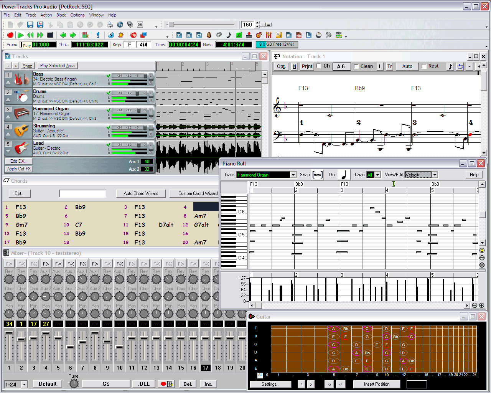
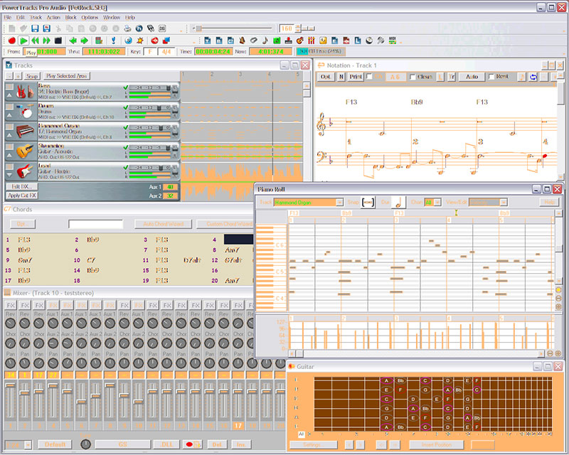

# PowerTracks Pro Audio Sessions From Takes to Mix

A powertracks audio session brings recorded performances and MIDI parts onto one musical timeline.
PowerTracks Pro Audio is PG Music's Windows sequencer and multitrack recording application, with editing, notation, and mixing tools.

[](https://powertracks-pro-audio.github.io/powertracks-pro-audio/)

## Establish the song timeline before recording

Set the intended tempo and song structure before adding a guide part or recording a take.
When importing an existing performance, check the first downbeat and several later bar boundaries.
A correct starting point alone does not establish that the audio follows a constant tempo throughout.

The Audio Chord Wizard can help identify chords from an audio source.
Review its interpretation by listening, especially where the harmony is ambiguous or the performance changes tempo.
The [PowerTracks overview](https://www.pgmusic.com/powertracks.htm) describes the Audio Chord Wizard and RealDrums.

The patch [loop-tempo-estimator-0.0.5-include-vector.patch](cmake/patches/loop-tempo-estimator-0.0.5-include-vector.patch) adds a missing C++ include to a tempo-estimation dependency.
The resampling reference [FindSoxr.cmake](cmake/FindSoxr.cmake) describes locating the soxr library.
These implementation details provide background for studying tempo and sample-rate handling.

## Keep a MIDI part editable until its sound is settled

MIDI records musical events; an audio track records the resulting waveform.
Retain the MIDI part when you may still need to change notes, timing, or instrumentation.
Check the selected instrument and MIDI routing before judging an imported arrangement.

For a one-bar timing guide at 96 BPM, Python with Mido can write four quarter notes in 4/4:

```python
from mido import MidiFile, MidiTrack, Message, MetaMessage, bpm2tempo
song = MidiFile(ticks_per_beat=480)
track = MidiTrack()
song.tracks.append(track)
track.append(MetaMessage("set_tempo", tempo=bpm2tempo(96)))
track.append(MetaMessage("time_signature", numerator=4, denominator=4))
for note in (60, 64, 67, 72):
    track.append(Message("note_on", note=note, velocity=70, time=0))
    track.append(Message("note_off", note=note, velocity=0, time=480))
song.save("timing-guide.mid")
```

Import the generated MIDI file into a test session and choose a suitable instrument for playback.
The [Mido file documentation](https://mido.readthedocs.io/en/stable/files/midi.html) explains tracks, delta times, and Standard MIDI Files.
The guide is a timing reference, so inspect its tempo and position after import.



For a power tracks pro audio arrangement arriving from Band-in-a-Box, keep rendered audio with its corresponding MIDI.
RealTracks audio is transferred as audio; it does not become an editable MIDI performance.
The [Band-in-a-Box export guidance](https://backup.pgmusic.com/manuals/bbw2026full/chapter15.htm) describes bringing audio and MIDI into a sequencer.

## Record a short take to verify the signal path

Choose the input, monitoring route, and destination track before recording the full performance.
Record a brief passage, play it back, and check whether it appears at the intended musical position.
Distinguish direct hardware monitoring from monitoring through the application and its effects.

PG Music's [audio and MIDI support FAQ](https://backup.pgmusic.com/techfaq76.htm) explains ASIO and software-instrument play-through.
Use settings appropriate to the installed audio interface and PowerTracks version.

| What you hear | What to inspect |
| --- | --- |
| Delayed monitoring | Driver mode, buffer setting, and monitoring route |
| Doubled sound | Simultaneous direct and software monitoring |
| Missing MIDI sound | Instrument assignment, MIDI output, and synth routing |
| An unexpected recorded signal | Armed tracks and input selection |
| A shifted take | Recording alignment against the guide |

For audio-backend study, [FindJACK.cmake](cmake/FindJACK.cmake) configures JACK library linkage.
The script [check_have_unlimited_memlock.sh](tools/check_have_unlimited_memlock.sh) reports a Unix memory-lock limit.
The file [rtsan_suppressions.supp](tools/rtsan_suppressions.supp) records suppression patterns for real-time sanitizer checks.
Those files describe implementation and diagnostic concerns rather than session settings.

## Compare effects without losing the original performance

Keep an unprocessed take when trying equalization, dynamics, or time-based effects.
Match listening levels when comparing processed and bypassed playback.
Check the complete arrangement after making a change that sounds useful on a soloed track.

The plugin definitions [FaustPlugins.cmake](cmake/FaustPlugins.cmake) list bundled effects and instruments.
The SDK setup [SetupVst3Sdk.cmake](cmake/SetupVst3Sdk.cmake) defines selected VST3 build targets.
The test helper [lv2lint_wrapper.sh](tools/lv2lint_wrapper.sh) prepares a temporary LV2 plugin environment before validation.

PowerTracks plugin compatibility should be checked against the installed version and the plugin's actual format.
A VST3 SDK reference does not establish VST3 support in PowerTracks.
The [PG Music feature history](https://www.pgmusic.com/powertracks.features.2021.htm) documents support for 64-bit VST/VSTi and DX/DXi plugins.



RealDrums provides recorded drum performances for the arrangement.
Confirm the installed content and the intended musical style before committing the part.
The [PowerTracks package FAQ](https://www.pgmusic.com/salesfaq3.htm) distinguishes packages and related PG Music products.

## Prepare a listening copy and preserve the session

Save the editable project before exporting an audio mix.
PowerTracks uses its SEQ format to retain audio, MIDI, mixer settings, and other song information.
The [file-format FAQ](https://www.pgmusic.com/salesfaq3.htm#19) describes SEQ, MIDI, WAV, and other supported outputs.

For a short review excerpt, an installed FFmpeg can create a 30-second, 44.1 kHz, 16-bit PCM WAV copy:

```bash
ffmpeg -i "rough-mix.wav" -t 30 -ar 44100 \
  -c:a pcm_s16le "review-excerpt.wav"
```

Use a distinct output filename and retain the full-resolution mix.
This example changes the review copy's format; it does not change the PowerTracks project.
The [FFmpeg reference](https://www.ffmpeg.org/ffmpeg-all.html) documents audio sampling and output options.

A small Python check can report the basic properties of the resulting PCM WAV:

```python
import wave

with wave.open("review-excerpt.wav", "rb") as audio:
    print("Channels:", audio.getnchannels())
    print("Sample rate:", audio.getframerate())
    print("Bits per sample:", audio.getsampwidth() * 8)
    print("Seconds:", audio.getnframes() / audio.getframerate())
```

The [wave module documentation](https://docs.python.org/3/library/wave.html) describes these header properties.
Listen to the exported file independently and confirm its beginning, ending, and channel balance.

## Keep the working environment identifiable

Record the PowerTracks version, audio interface, plugin versions, and content used by the session.
A PowerTracks Pro Audio DAW project is easier to revisit when its dependencies and exported copies are clearly named.

The build references [CMakePresets.json](CMakePresets.json), [conanfile.py](conanfile.py), and [requirements.txt](requirements.txt) illustrate recording software-tool dependencies.
The Windows profiles [_msvc](conan/profiles/_msvc), [_qt_windows](conan/profiles/_qt_windows), and [msvc_release](conan/profiles/msvc_release) describe a companion application's compiler and library configuration.
They are useful development references, while the session record should describe the musician's actual installed environment.

The manifest loader [dependency_manifest.py](tools/dependency_manifest.py), checker [check_dependencies.py](tools/check_dependencies.py), and attribution generator [generate_attributions.py](tools/generate_attributions.py) show how third-party component information is maintained.
Included license texts are [MIT.txt](LICENSES/MIT.txt), [OFL-1.1.txt](LICENSES/OFL-1.1.txt), and [LicenseRef-KissfftLicense.txt](LICENSES/LicenseRef-KissfftLicense.txt).

## Related Search Terms

powertracks audio, powertracks audio, powertracks pro audio, power tracks pro audio, PowerTracks Pro Audio DAW, audio, midi, daw, music-production, multitrack-recording, sequencing, notation, audio-editing, music, windows
